<!-- featured-work:start -->
<!-- Generated by scripts/featured/build.mjs from scripts/featured/projects.json — edit the JSON, not this block. -->

<a href="https://joyntoghosh.vercel.app"></a><a href="https://joyntoghosh.vercel.app"></a><a href="https://joyntoghosh.vercel.app/#projects"></a><a href="https://joyntoghosh.vercel.app"></a> 
<a href="https://joyntoghosh.vercel.app"></a> 
<a href="https://joyntoghosh.vercel.app/#projects"></a> 
 
<a href="https://joyntoghosh.vercel.app/#projects"></a> 
<a href="https://github.com/joynto7/Sentra"></a><a href="https://agro-sync-seven.vercel.app/"></a><a href="https://fixitnow-frontend-peach.vercel.app"></a><a href="https://client-eight-rho-92.vercel.app"></a> 
<a href="https://github.com/joynto7/Sentra"></a><a href="https://github.com/joynto7/Sentra"></a><a href="https://agro-sync-seven.vercel.app/"></a><a href="https://joyntoghosh.vercel.app/case-studies/agrosync"></a><a href="https://fixitnow-frontend-peach.vercel.app"></a><a href="https://github.com/joynto7/fixitnow-frontend"></a><a href="https://client-eight-rho-92.vercel.app"></a><a href="https://github.com/joynto7/Novi"></a> 
 
<a href="https://github.com/joynto7?tab=repositories"></a><a href="https://github.com/joynto7?tab=repositories"></a> 
<a href="https://github.com/joynto7/surplusbid-backend"></a><a href="https://club-connect-rust.vercel.app"></a><a href="https://github.com/joynto7/devpulse"></a><a href="https://github.com/joynto7/network-analysis"></a> 
<a href="https://joyntoghosh.vercel.app/#skills"></a> 
<a href="https://joyntoghosh.vercel.app"></a><a href="https://joyntoghosh.vercel.app"></a>

<!-- featured-work:end -->

<b>More about me</b>

 

I'm a Software Engineering student at Daffodil International University who builds full-stack web apps end to end, from real-time IoT dashboards to marketplaces. Right now I'm co-building [Sentra](https://github.com/joynto7/Sentra), a platform that finds and fixes security flaws in AI apps.

- **Open to:** software engineering internships and junior full-stack roles, in Dhaka or remote
- **Education:** BSc in Software Engineering, DIU · graduating December 2027
- **Competitive programming:** competed in the final of DIU Unlock the Algorithm (Spring 2026), an invite-only ICPC-style contest
- **Contact:** [Portfolio](https://joyntoghosh.vercel.app) · [LinkedIn](https://www.linkedin.com/in/joynto7/) · [Email](mailto:jg.contact.me07@gmail.com) · [CV](https://joyntoghosh.vercel.app/CV.pdf)

