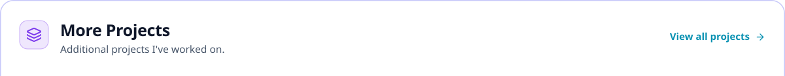

  <a href="https://joyntoghosh.vercel.app">
    <picture>
      <source media="(prefers-color-scheme: dark)" srcset="assets/header-dark.svg">
      
    </picture>
  </a>

I'm a Software Engineering student at Daffodil International University who builds full-stack web apps end to end, from real-time IoT dashboards to marketplaces. Right now I'm co-building [Sentra](https://github.com/joynto7/Sentra), a platform that finds and fixes security flaws in AI apps.

- **Open to:** software engineering internships and junior full-stack roles, in Dhaka or remote
- **Education:** BSc in Software Engineering, DIU · graduating December 2027
- **Competitive programming:** competed in the final of DIU Unlock the Algorithm (Spring 2026), an invite-only ICPC-style contest
- **Contact:** [Portfolio](https://joyntoghosh.vercel.app) · [LinkedIn](https://www.linkedin.com/in/joynto7/) · [Email](mailto:jg.contact.me07@gmail.com) · [CV](https://joyntoghosh.vercel.app/CV.pdf)

<!-- featured-work:start -->
<!-- Generated by scripts/featured/build.mjs from scripts/featured/projects.json — edit the JSON, not this block. -->

<a href="https://joyntoghosh.vercel.app/#projects"><picture><source media="(prefers-color-scheme: dark)" srcset="assets/featured/hero-dark.svg"></picture></a> 
<a href="https://joyntoghosh.vercel.app/#projects"><picture><source media="(prefers-color-scheme: dark)" srcset="assets/featured/cta-projects-dark.svg"></picture></a><a href="https://joyntoghosh.vercel.app/#contact"><picture><source media="(prefers-color-scheme: dark)" srcset="assets/featured/cta-contact-dark.svg"></picture></a>

<a href="https://joyntoghosh.vercel.app/#projects"><picture><source media="(prefers-color-scheme: dark)" srcset="assets/featured/selected-dark.svg"></picture></a> 
<a href="https://github.com/joynto7/Sentra"><picture><source media="(prefers-color-scheme: dark)" srcset="assets/featured/card-sentra-dark.svg"></picture></a><a href="https://agro-sync-seven.vercel.app/"><picture><source media="(prefers-color-scheme: dark)" srcset="assets/featured/card-agrosync-dark.svg"></picture></a> 
<a href="https://github.com/joynto7/Sentra"><picture><source media="(prefers-color-scheme: dark)" srcset="assets/featured/link-source-blue-dark.svg"></picture></a><a href="https://github.com/joynto7/Sentra"><picture><source media="(prefers-color-scheme: dark)" srcset="assets/featured/team-3-dark.svg"></picture></a><a href="https://agro-sync-seven.vercel.app/"><picture><source media="(prefers-color-scheme: dark)" srcset="assets/featured/link-live-green-dark.svg"></picture></a><a href="https://joyntoghosh.vercel.app/case-studies/agrosync"><picture><source media="(prefers-color-scheme: dark)" srcset="assets/featured/link-case-green-dark.svg"></picture></a> 
<a href="https://fixitnow-frontend-peach.vercel.app"><picture><source media="(prefers-color-scheme: dark)" srcset="assets/featured/card-fixitnow-dark.svg"></picture></a><a href="https://client-eight-rho-92.vercel.app"><picture><source media="(prefers-color-scheme: dark)" srcset="assets/featured/card-occasio-dark.svg"></picture></a> 
<a href="https://fixitnow-frontend-peach.vercel.app"><picture><source media="(prefers-color-scheme: dark)" srcset="assets/featured/link-live-indigo-dark.svg"></picture></a><a href="https://github.com/joynto7/fixitnow-frontend"><picture><source media="(prefers-color-scheme: dark)" srcset="assets/featured/link-source-indigo-dark.svg"></picture></a><a href="https://github.com/joynto7/fixitnow-backend"><picture><source media="(prefers-color-scheme: dark)" srcset="assets/featured/link-api-indigo-dark.svg"></picture></a><a href="https://client-eight-rho-92.vercel.app"><picture><source media="(prefers-color-scheme: dark)" srcset="assets/featured/link-live-magenta-dark.svg"></picture></a><a href="https://github.com/joynto7/Novi"><picture><source media="(prefers-color-scheme: dark)" srcset="assets/featured/link-source-magenta-dark.svg"></picture></a>

<a href="https://github.com/joynto7?tab=repositories"><picture><source media="(prefers-color-scheme: dark)" srcset="assets/featured/more-top-dark.svg"></picture></a> 
<picture><source media="(prefers-color-scheme: dark)" srcset="assets/featured/more-edge-left-dark.svg"></picture><a href="https://github.com/joynto7/surplusbid-backend"><picture><source media="(prefers-color-scheme: dark)" srcset="assets/featured/other-surplusbid-dark.svg"></picture></a><a href="https://club-connect-rust.vercel.app"><picture><source media="(prefers-color-scheme: dark)" srcset="assets/featured/other-club-connect-dark.svg"></picture></a><a href="https://github.com/joynto7/devpulse"><picture><source media="(prefers-color-scheme: dark)" srcset="assets/featured/other-devpulse-dark.svg"></picture></a><a href="https://github.com/joynto7/network-analysis"><picture><source media="(prefers-color-scheme: dark)" srcset="assets/featured/other-network-traffic-analyzer-dark.svg"></picture></a><picture><source media="(prefers-color-scheme: dark)" srcset="assets/featured/more-edge-right-dark.svg"></picture> 
<picture><source media="(prefers-color-scheme: dark)" srcset="assets/featured/more-bottom-dark.svg"></picture>

<a href="https://joyntoghosh.vercel.app/#skills"><picture><source media="(prefers-color-scheme: dark)" srcset="assets/featured/tech-heading-dark.svg"></picture></a> 
<a href="https://joyntoghosh.vercel.app/#skills"><picture><source media="(prefers-color-scheme: dark)" srcset="assets/featured/tech-stack-dark.svg"></picture></a>

<a href="https://joyntoghosh.vercel.app"><picture><source media="(prefers-color-scheme: dark)" srcset="assets/featured/footer-left-dark.svg"></picture></a><a href="https://github.com/joynto7"><picture><source media="(prefers-color-scheme: dark)" srcset="assets/featured/social-github-dark.svg"></picture></a><a href="https://www.linkedin.com/in/joynto7/"><picture><source media="(prefers-color-scheme: dark)" srcset="assets/featured/social-linkedin-dark.svg"></picture></a><a href="mailto:jg.contact.me07@gmail.com"><picture><source media="(prefers-color-scheme: dark)" srcset="assets/featured/social-email-dark.svg"></picture></a><picture><source media="(prefers-color-scheme: dark)" srcset="assets/featured/footer-right-dark.svg"></picture>

<!-- featured-work:end -->
